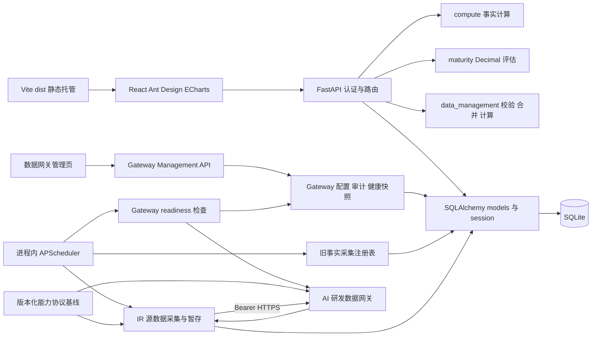

# Current Architecture

## 边界与技术栈

一个 React 19 客户端和一个 FastAPI 服务；Ant Design 提供 UI，ECharts 提供图表，React Router 管理页面。SQLAlchemy 2 管理默认 SQLite 存储，Pydantic 校验 HTTP DTO，APScheduler 3 在服务进程内调度。Radar 通过同步 HTTPX 客户端调用 AI 研发数据网关；Gateway 源码不在本仓库，采集链路当前只覆盖设计活动的 IR 源数据，开发活动记录不进入采集。双方共同依赖版本化能力协议，Radar Pydantic 模型只是消费端实现。

路由查询数据库后交给计算函数，不由图表决定统计口径。源数据 API 编排校验、权限和事务。旧事实采集仍走 FactRecord 注册表；IR 源采集由 `source_collection.py` 读取一次 Active 配置形成不可变快照，经 AI 研发数据网关执行并写入暂存批次，不触碰正式设计记录或旧事实链路；开发活动只有页面维护和文件导入，不进入采集。配置、最新健康状态和配置审计由 Gateway 管理模块持久化；健康检查与采集复用同一个进程内 APScheduler。协议工作区保存最新完整基线和逐版本变化，消费者固定发布 tag 或 commit。图中的 Gateway 关系代表 Radar 侧实现，不代表真实内部平台联调已通过。

## 核心模块与依赖方向

| 模块 | 职责 | 约束 |
|---|---|---|
| `main.py` | 组装中间件、路由、lifespan、静态托管 | 启动和关闭调度器 |
| `auth.py` | session、密码及角色/团队权限 | 后端授权，每次加载用户 |
| `api.py` | 认证、目录、事实、成熟度 | 调用纯计算和 ORM |
| `schemas.py` | HTTP 请求/响应 Pydantic DTO | `ComputePointOut.fact_count` 标出各团队周期事实数，响应用它区分缺失与记录值 0 |
| `data_api.py` | 组织、设计/开发活动需求记录、批次、本地 AI MR 检视意见 | 复用 data_management 规则；意见 API 执行团队权限 |
| `gateway_api.py` / `gateway_config.py` | 管理 Active/Draft、实时激活、配置审计和 CollectionRun runtime snapshot | admin-only；Token 不进入读取响应、审计、run 或日志 |
| `gateway_health.py` | readiness 状态转换、最新状态持久化、stale 判定及立即/周期检查 | 复用 APScheduler；每 30 秒检查 Active；不保留时序 |
| `source_collection.py` / `collector_gateway.py` | IR 周期窗口、按团队运行、显式 runtime snapshot 的 Gateway HTTPS 调用及暂存 | 同一 CollectionRun 所有团队共用一份快照；不自动重试 |
| `gateway_contracts.py` / `collector_contracts.py` | Readiness 与 IR 的严格 Pydantic 消费端模型 | 与版本化 OpenAPI 基线做一致性测试 |
| `requirement_fields.py` / `requirement_template.py` | 设计与开发活动字段注册表、模板列顺序及 xlsx 模板生成 | 模板列顺序、必填和枚举是活动契约；`ir_fields.py` / `ir_template.py` 保留设计兼容入口 |
| `requirement_imports.py` / `ir_imports.py` | 两个活动文件导入与设计采集共用的行校验、引用解析及批次创建 | 采集批次必须绑定团队；开发活动只允许文件导入 |
| `compute.py` / `maturity.py` | 事实和评估计算 | 不依赖 HTTP 或数据库查询 |
| `data_management.py` | 活动需求记录规范化、解析、差异、合并和指标 | 不承担 HTTP 编排 |
| `code_review_metrics.py` | 将 AIReviewOpinion 按团队/日投影为有效检视指标事实 | 复用 `compute.py` 序列计算；派生事实不持久化 |
| `models.py` / `db.py` / `migrations.py` | 实体、session、现有库增量 schema | 没有通用迁移框架 |
| `collectors.py` / `scheduler.py` | 接口注册、定时事实采集及配置化源数据采集 | Gateway 健康任务沿用同一个 Scheduler；没有真实平台实现 |

客户端共用 `api.js` 的 `fetchJson` 携带 cookie 和统一 HTTP 异常；领域页面拆出逻辑和图表配置。当前路径由 `routing/routeMetadata.js` 定义：`/`、`/analytics/activities`、`/analytics/capabilities`、`/analytics/teams/:teamId`、`/analytics/metrics/:metricId`、`/data/requirements/{design|development}`、`/data/maturity`、`/data/{issues|mr|code-review}`、`/settings/*`（含管理员 `/settings/collections` 与 `/settings/gateway`）；旧 `ir`/`sr` 需求路径重定向到设计活动、`ar` 重定向到开发活动，`/data-management/*` 重定向到对应新分类，未知活动回退设计活动，旧 `/?category=key|general` 重定向到活动/能力页。

AppShell 分别持有桌面折叠选择、matchMedia 窄屏状态与抽屉开关。localStorage 的 ai-dev-radar.sidebar-collapsed 只保存桌面布尔偏好；读取失败默认展开，写入失败不影响使用。监听 680px 断点，变化时关闭抽屉并恢复独立桌面选择。桌面 CSS 用同一自定义宽度变量同步 248px/64px 侧栏宽度与正文左偏移，并以 240ms cubic-bezier(.2,0,0,1) 过渡；首屏直接使用保存状态，连续切换由 CSS 从当前动画位置反向过渡，prefers-reduced-motion: reduce 时禁用新增过渡。Topbar 为 56px，包含 Breadcrumb、按当前角色过滤的导航项搜索、需求活动/分析活动/成熟度常用入口、账户和会话操作；搜索只导航到现有路由，不查询业务记录，通知图标保持禁用状态并提示通知能力未开放。Topbar 不承载路由页面标题。

AppShell 在主要内容区内捕获 lazy route 的 Suspense，以 `ContentLoadingState` 加载页面模块时保留导航和 Topbar。`frontend/src/components/StatusPage.jsx` 提供共享 403、404、pending、fatal-error 页面及内容加载状态。`App.jsx` 在认证服务确认用户前独立展示认证加载状态；登录页、401 重新认证和返回中断路径仍由 App 管理，不新增 token refresh。

AppShell 按路由给内容区标记 dashboard、analytics、operational 或 readable 模式。Dashboard/Analytics 使用侧栏后的 fluid canvas 和 24px–40px gutter；大多数系统管理路由（包括数据采集）使用 1600px Operational 表格/工作流宽度，`/data/*` 需求活动工作台使用全宽 Data Workbench 内容模式；`/settings/gateway` 使用上限 1120px 的 Readable 配置画布。`.app-shell__content` 只裁切横向溢出（`overflow-x: clip`），不建立纵向滚动容器；Analytics 文档由浏览器负责纵向滚动，活动目录与能力结构导航以 sticky 定位在 Topbar 下方。Sidebar 的固定定位与内部导航滚动仍独立。

`frontend/src/design/tokens.css` 是 light mode 的运行时语义 token 源，涵盖基础 Surface、状态、团队系列、benchmark、成熟度色阶、排版、间距和控制高度。`design-system.css` 持有滚动条、全局排版/网格、PageHeader/FilterToolbar、Analytics primitives、状态及 Operational workspace 样式；`theme.js` 将语义色、字体、间距和控制高度映射到 Ant Design，`charts/chartTheme.js` 为 ECharts 读取同一数据可视化 token。应用和页面 CSS 直接消费 canonical tokens，`app.css` 只保留 `--shell-sidebar-width` 这类真实壳层状态，不再提供兼容色值别名。`components/PageHeader.jsx`、`FilterToolbar.jsx`、`MetricCard.jsx` 和 `AnalyticsComponents.jsx` 只负责呈现，不拥有领域/API 状态；后者提供 `AnalyticsSection`、`ChartCard`、`BenchmarkLegend`、`AnalyticsDirectory`、`MaturityMatrix` 和 `TeamMatrix`。`FocusRestoringDrawer.jsx` 包装 Ant Design Drawer，在保留模态与键盘行为的同时把关闭后的焦点还给触发操作；移动导航 Drawer 仍由 AppShell 显式恢复打开按钮焦点。`StatusPage.jsx` 提供共享状态组件，ECharts 业务映射仍由对应图表选项文件负责。`premium-ui.json` 为 UI 静态审计声明产品配置和已接受的原生 Select/Listbox、Date 控件归属。AnalyticsPages、DataManagement、AppShell 与 TeamDrilldown 的运行时 CSS 使用语义 tokens；指标详情共享 Analytics 图表样式。DataManagementPage 的设计/开发活动表把 `FilterToolbar` 放在 Table 之前，并由 Table 自己处理 sticky header/局部横向滚动；团队、产品、指标管理复用 shared settings workspace，成熟度和活动工作台布局仍留在 `dataManagement.css`，`.ir-*` 视觉层由 `ir-workbench.css` 保留。UsersSettingsPage、CollectionsSettingsPage 和数据管理各主工作区复用 PageHeader；用户权限使用 operational table，采集设置使用摘要、section 和可展开运行历史。登录页继续由 App 拥有认证请求，使用 `noValidate`、字段 ARIA 关联和表单内错误；认证失败不向用户暴露原始服务错误。App 监听路由路径并为登录、洞察、数据管理和系统管理页面设置本地化 `document.title`。

AppSidebar 的品牌区放共享的 frontend/public/favicon.svg 雷达 Logo 和折叠按钮：展开时水平分列，折叠后垂直居中；展开态使用 MenuFoldOutlined 收起侧栏，折叠态使用 MenuOutlined，按钮保留 Tooltip、ARIA 标签及键盘焦点反馈。按钮为 40×40px，hover 缩放 1.06、active 缩放 0.94，颜色/背景/缩放过渡 160ms；prefers-reduced-motion: reduce 时关闭按钮过渡和缩放。共享 SVG 为蓝色圆形雷达环、实色青色扫描线和三个数据点，供侧栏、抽屉、登录页和 favicon 使用。中间 app-nav 独立滚动，文字使用透明度与最大宽度裁切保持单行。窄屏使用现有 Ant Design Drawer，抽屉和侧栏共用 #F8FAFD 浅色表面，不保留折叠图标栏，关闭后由 AppShell 恢复顶栏打开按钮焦点，避免过渡期间与 Ant Design 默认恢复时机竞争。AppSidebar 复用角色过滤与路由元数据，数据管理直接提供四类来源链接，需求子路由共享所属入口样式；总览及其下钻同样使用所属入口样式，精确匹配才使用 aria-current=page。折叠切换不发业务请求、不改变权限。

`AnalyticsPages` 将研发总览、研发活动和研发能力拆成三个同级只读页面，以 URL `month` 作为共同分析月份。总览只用 URL `month` 与 `cycle`；IR 请求读取选定月份前 12 个月并传 `version_id=all`，四项周期 KPI 在已读取序列上按周期客户端汇总，不发送版本过滤，由 `irKpiData.js` 派生当前四项临时 IR 全局 KPI、趋势、团队矩阵和团队预览。API 仅返回受权限范围约束的团队/月度 AI 属性计数与总工作量聚合，不返回 IR 标识或人员字段。月度/周期卡片采用域汇总值；趋势和团队矩阵的 `全公司均值` 是有值团队的等权平均。四个 KPI 标签已确认，但 IR 数据映射和公式仍为临时口径。总览的关键活动概览仍使用 `/api/compute` 的 FactRecord：Overview 当前按用户决定排除 `dta`/`dtf`，其余展示活动按 `penetration` 与 `efficiency` 类型映射到 AI需求渗透率、AI研发提效两个槽位，图表说明保留来源目录指标名；缺少对应类型时显示缺失，不以其它类型代替。研发活动页和研发能力页继续呈现原 FactRecord 目录指标，不混用 IR 数值。总览核心趋势与关键活动并排；团队矩阵将四项临时全局 KPI 分为指标值/变化列，并遵循相同的月度与周期变化语义；选中团队预览 IR 渗透率和效率；成熟度仍按所选 key/general 类型展示团队矩阵和本期、上期领域平均雷达，矩阵下方提供 0.0 与 1.0–5.0 热力色阶，未评估保持缺失。成熟度不从事实指标推导；总览不创建 Target。活动页与能力页共用 `.analytics-directory-workspace` 的 220–240px 垂直目录和全宽 workspace，但目录选择为页面本地状态。活动页所选 key activity 决定单指标查询范围；页面分析维度固定为时间，只将 month、cycle、granularity、period 和 metric 等有效筛选写入 URL。活动路由忽略并清除旧 version 与 dimension=iteration 状态，FactRecord 请求不附带 version_id，因此时间事实跨版本纳入。“全部周期”只显示完整趋势，不显示单周期快照。Activity 页的上方活动 KPI 与两张趋势继续读取所选 key activity 的 `/api/compute` FactRecord。下方页面级团队差异、IR 覆盖拆解和工作量趋势复用现有 `/api/data-metrics/overview` 与 `irKpiData.js` 全局 IR 聚合，固定 raw summary 的测试用例生成/执行值读取对应 `/api/compute` 指标；这些 lower reads 不携带所选 Activity，因此目录切换不会改动其值或请求。同比读取当前窗口和去年同月窗口，两次均不超过 API 已有的 12 个月范围；无需新增 endpoint、schema 或持久化模型。能力页按目录类型区分状态、指标趋势、团队差异和成熟度：布尔能力逐团队展示状态，数值指标矩阵保持每个指标独立，成熟度使用自然月且不从事实指标推导。FactRecord 趋势仍以同指标 `company_average` 为团队基准，量化详情将其与 `domain_summary` 合并原始量分开呈现。`ComputePointOut.fact_count` 标记每团队/周期事实数，缺失数量点为 null，FactRecord `company_average` 排除无事实团队。标题与筛选工具栏由共享 `PageHeader` 和 `FilterToolbar` 提供。

`overviewLogic.js` 为选定月份生成以该月为终点的 FactRecord 时间窗口；`metricDataForPeriods` 将稀疏团队点与周期轴对齐，为无事实周期保留 null，避免折线或悬浮值移到相邻月份。`irKpiData.js` 从 IR 总量和团队月度聚合计算临时全局 KPI，缺失 AI 属性或工作量时保留空值，不从 FactRecord 填补。成熟度 overview 通过既有 `/api/maturity/overview` 读取选定类别与自然月，并返回已有历史序列；成熟度仍使用后端领域平均，矩阵把未评估与有效 0 分开呈现。

Overview 的研发关键环节一次限定为一个目录活动，因此图中的 `company_average` 仅指该活动、该指标下有事实团队值的等权算术平均；UI 标签使用“领域平均”，不表示合并原始量的 `domain_summary`，也不改变 `/api/compute` 响应或计算。

TeamDrilldown 按“整体表现 → 研发关键环节 → 成熟度画像”组织单页内容，并通过 sticky 锚点导航定位三个 section。月份、统计周期和版本均在顶部 FilterBar。整体表现的月度/周期四张 KPI 卡与渗透率/提效双趋势复用 `/api/data-metrics/overview` 和 `irKpiData.js` 的临时 IR 聚合；未选版本时当前团队值与有值团队均值来自 All 结果。选择具体版本时，当前团队值读取该 `version_id` 结果；领域参照另读 `version_id=all`，两次查询保持相同月范围，卡片周期值按无版本各团队序列等权汇总。版本切换保留用户选定的事实周期；该范围无当前团队事实时仍显示缺失。时间趋势复用 Overview `buildTrendOption`，只绘制当前团队与同范围领域参照，不展示 peer 团队。仅一个团队有值时，页面显示有效团队数并说明暂不可多团队对照。

研发关键环节与事实证据通过 `/api/compute` 读取 FactRecord；每项关键活动按 `penetration` / `efficiency` 映射到 AI需求渗透率、AI研发提效两个固定槽位，DTS 活动保留在 Team 页面，缺失类型不借用其他指标。按时间分析时，当前团队查询保留所选版本，领域参照使用相同指标、时间维度和粒度的无版本响应；迭代分析时，当前团队值来自版本化迭代响应，领域参照读取无版本的日事实，并限定在所选迭代含首尾日期范围内。`drilldownLogic.iterationReferenceAverage` 按现有指标公式先汇总每支团队的原始字段，再对有事实且有有效结果的团队等权平均；布尔指标不造均值。页面分别标注“领域参照 · 不限版本”与“领域参照（同日期范围、不限版本）”，不展示其他团队趋势或同版本排名。趋势使用 Overview `buildTrendOption` 的 ±100% 提效异常点显示和原始 tooltip；迭代柱图也钳制绘制值并在 tooltip 中保留原始值。

成熟度并列显示本期团队、上期团队和本期领域平均：当前与上期团队记录分别取 `/api/maturity/records?team_id=…&month=…`，key/general 领域本期平均来自 `/api/maturity/overview?kind=key|general`。零分仍是有效值，缺失保持 null；通用研发能力始终使用自然月，不随迭代维度伪造评估。共享 `MaturityRadar` 基础样式位于 `design-system.css`，复用团队颜色槽位与中性领域基准样式。本次复用既有事实、成熟度与 IR 聚合接口，不改变权限或持久化语义。Metric Detail 在单周期下排序同一指标的团队值；全部周期只展示趋势，不声称当前值或当前周期原始事实。

TeamDrilldown 的整体表现、研发关键环节、成熟度画像分别由一个 `AnalyticsPanel` 承载，标题和说明与各自数据同卡呈现。整体表现卡包含两行 KPI 和双趋势，生命周期卡包含活动卡和所选活动双趋势，成熟度卡通过类别切换一次呈现 key/general 中的一组矩阵与雷达，默认 key。页面标题、FilterBar 和返回来源操作共用页头区域，Sticky Section Navigation 位于其下方，文档持有纵向滚动。`drilldown.css` 为 Team KPI 使用横向迷你趋势布局并在超宽视口限制内容最大宽度；当前 KPI 缺失时迷你趋势保持空态，图表与间距仍使用语义 token。IR 与 FactRecord 趋势依据版本范围使用各自的等权基准标签；仅一支团队有值时展示不可进行多团队对照的说明，不填补数据。

Team Drill-down routes select `团队详情` in AppSidebar and use Team Detail route metadata in the breadcrumb. Overview, Activity, Capability, and Metric Detail row actions pass a source label and return path in router state; AppShell keeps that source visible in the breadcrumb and TeamDrilldown returns to it. Direct Team Detail URLs default the return action to Overview. Push/replace path changes scroll the document to the top, while browser POP navigation retains native scroll restoration.

Capability status renders the selected capability's maturity score and assessment coverage from the existing maturity overview separately from its FactRecord penetration/rate and count metrics; none is aggregated with another source. Capability maturity reuses the existing overview/history API response for all general-capability activities. AnalyticsPages renders the actual general capabilities as a team-score matrix and compares current/previous domain averages on a radar. The schema stores one score per team, activity, and month; the radar axes are existing capabilities, not inferred sub-dimensions.

General-capability FactRecord queries use the selected month and month/week/day granularity. The single-period cards use the latest period in that window; trends use six monthly, twelve weekly, or thirty daily periods. General capabilities have no iteration/version scope; the toolbar exposes Month and Granularity only, normalizes away legacy version/iteration URL state, and sends no version filter.

Overview 的月度/周期 KPI 卡使用 `MetricKpiCard`；核心趋势、研发关键环节、成熟度矩阵/雷达、团队矩阵/趋势预览分别由单个 `AnalyticsPanel` 提供外层卡片边界，标题和说明随内容留在卡片内。Overview 的配比、卡片节奏、生命周期图标和图表高度由 `analytics.css` 管理；已批准的 BR-02 允许 2560×1440 的实际绘图区随视口高度扩展，并由相应面板容纳。`MaturityRadar` 的基础 SVG、图例、说明和数据表样式归共享 `design-system.css`，Overview 只负责局部尺寸。代码检视、`dta`、`dtf` 的隐藏仅作用于 Overview 生命周期展示，不改变 Catalog、成熟度、专页数据或 API 查询。成熟度范围通过 URL 参数 `maturity_category` 保存；旧的 `/?category=key|general` 继续仅用于导航重定向。

## 数据流和模型

事实链路：FactRecord → 当前有效事实选择 → 日/周/月或迭代切片 → 团队序列、`company_average` 和领域合并值。日周期按 `Asia/Shanghai` 自然日生成，中间无事实日期保留为空周期。需求设计活动链路：页面/文件或 Gateway → 共享行校验 → 带团队的临时批次 → 人工确认事务与审计 → 正式设计记录 → 只读的 `/api/data-metrics/overview` 聚合（只读取 `requirement_type=IR` 的设计记录）。需求开发活动链路：页面/文件 → 共享行校验 → 带团队的临时批次 → 人工确认事务与审计 → 独立的正式开发记录；开发记录不进入 Gateway 采集或总览临时 KPI。总览聚合只供总览临时 KPI 使用，不改变旧 `/api/compute` 的 FactRecord 合同，也不向事实页面填补数据。看板指标目录：`seed.py` CATALOG → 只读 `/api/catalog` → 指标字典展示；指标计算仍由 `/api/compute` 基于 FactRecord 分子/分母完成。源数据指标规则与结果查询原型不再提供。IR Gateway 采集范围由团队下的 Product/ProductVersion（PI）派生，不再读取 `Team.source_mapping.product_versions`；数据采集页只读取 `/api/gateway/status` 就绪投影，不复制 Gateway 配置。AI MR 检视意见链路：本地 `AIReviewOpinion` source_id/team/date/Boolean 记录 → 按团队和日期聚为临时日事实 → `/api/compute` 复用既有团队均值、合并结果和空值语义；源 API 与指标计算不依赖 Gateway，Gateway 代码检视采集仍为 planned。成熟度链路：团队月度维护 → MaturityRecord → Decimal 领域聚合；成熟度不从需求记录、FactRecord 或意见源推导。

`seed.py` 在空库初始化或显式重建时以 Asia/Shanghai 的执行日期为锚，写入近六个月的演示版本/迭代、全部目录事实、每月独立模拟成熟度评估、正式设计活动 IR 示例及开发活动演示记录。关键活动每个团队/指标/迭代只写一条事实；通用能力覆盖六个月的周采样及近三十天的日采样；布尔状态按月写入。`npm run seed` 与 `npm run dev` 均从项目根目录解析默认 SQLite 路径，并遵循显式 `DATABASE_URL`。生成过程使用固定随机种子，同一日期重跑结果稳定；业务数据清空重建仍是破坏性操作，测试使用隔离数据库。

团队产品层级支持源数据归属；人员关联责任工号。旧 ProductVersion 可无 product_id 是兼容形态，新管理版本必须绑定产品。更多模块细节见 [源数据模块](modules/data-management.md)。

## 运行与部署

lifespan 依次建表、增量 schema（含独立开发记录表）、检查活动目录并在为空时播种，确保 IR 默认禁用的调度配置存在，把已有 Active 健康状态标记为 `UNKNOWN`，再加载启用的源数据调度任务和立即执行的 `gateway-health-check`，最后启动同一个 APScheduler；Gateway 检查之后每 30 秒运行一次。关闭时等待调度器退出。旧 `COLLECTION_CRON` 任务继续处理 FactRecord。播种是否执行由目录是否为空决定，不能据此宣称所有缺失数据都会自动补齐。

本地 Vite 将 `/api` 代理到 8000 后端。Docker 多阶段构建 Vite，FastAPI 同源托管 dist，以单个 Uvicorn 进程启动，SQLite 放在 `/data` 卷。SPA fallback 仅处理无扩展名 GET 客户端路径，显式排除 `/api`，保留 API 404/405 语义。Gateway URL、Bearer Token 和 timeout 通过 admin-only 数据网关页面管理并存于 Radar 数据库；Token 按决策明文存储但绝不返回或写入审计/run/log。生产 Gateway URL 必须使用 HTTPS。E2E 测试资产由 `.dockerignore` 排除且 Dockerfile 不复制到生产镜像。环境变量详见 [README](../../README.md)。

进程内调度约束意味着扩展多 worker 会重复调度；当前部署采用单进程。生产配置拒绝默认密钥和种子密码，HTTPS 场景需启用 secure cookie。L3 Project E2E 只验证 Radar 与独立 Mock Gateway 的真实本机 HTTP 链路，不代表真实 Gateway 或内部平台联调通过。Docker 镜像、卷重启持久化、MySQL 与 L4 内网联调需部署验证，不从项目门禁推断。

## Active UX convergence target and implementation gap

The confirmed target for the active visual-convergence change narrows analytics query ownership without changing server schemas: Overview owns only `month` and `cycle`; it ignores/removes legacy `version` URL state. Activity keeps its time, granularity, period, and metric state but does not expose or send cross-team version/iteration scope; its time-based facts remain inclusive across versions. General Capability remains versionless.

Team Detail is the only analysis route with a version selector. Its named candidates are restricted to the selected Team's Product using the existing `/api/versions` ownership fields; product-less legacy versions remain represented only by All versions. With a named version, issue the selected Team value read with that version and the domain reference read for the same time range and metric across all teams without a version parameter. Keep those scopes separately labeled. Preserve the selected time range when the version lacks facts; return missing rather than resetting to a version-available period. These scopes are expressible with the current `/api/data-metrics/overview` and `/api/compute` query parameters, so no schema or API contract change is currently planned.

Current implementation and remaining gaps: Overview owns only `month` and `cycle`, removes legacy `version` state, and sends `version_id=all`; all six lifecycle cards use their direct catalog names. Its Month control is a keyboard-operable month dialog. The BR-03 R2 visual correction was independently reviewed at both desktop targets, and the user confirmed Overview with the accepted side-rail exception. Activity fixes its query dimension to time, removes the Version/Iteration controls, clears legacy route filters, and omits `version_id` from FactRecord requests. UI-ACT-01..19 passed issue-level review; the user accepted the Activity 14-42 candidate differences at both desktop sizes. Capability presents its directory in the Activity side-panel style and uses a Capability-only per-column heatmap. Non-maturity facts follow the selected ability; the seven-axis maturity matrix/radar remains independent. Independent review on the latest retained candidate passed UI-CAP-01..09 and UI-CAP-12..18 plus CAP-GEO-01 at both target viewports. The user approved the MR effective-review count/rate formula on 2026-10-14; a local opinion source record/API and computed metric mapping are being added. The status-card contract applies the user rule that only catalog-defined indicators appear; its two-track geometry passed fresh independent review and is closed. UI-CAP-13 is closed: Business defines no cross-capability score or formula, so the sample total column is omitted. The user's latest alignment/radar/table report was rechecked in live Chrome and against the current two-viewport evidence; the complete radar series closes, while missing axes remain gaps. The user accepted the Capability 15-02 candidate differences at both desktop sizes. Team Detail restricts named version candidates to non-null products owned by the current team; invalid foreign/product-less `version` URL state normalizes to All. With a selected version, the current Team query uses that version while a separate all-team reference query omits version scope; the views label those ranges separately. Iteration references use unversioned daily facts for the same date range, aggregate within each team, then calculate the equal-weight team mean. Current candidate tests preserve the selected period when it has no matching facts. UI-TD-01/02/04/05/06 and TEAM-GEO-01 passed independent review on the latest candidate with stable loading/error geometry, generic retry copy, 85px overall plots and 75px lifecycle plots. UI-TD-03 is closed as a user-accepted Key Findings composition difference after fresh two-viewport independent review; The user accepted the Team Detail 14-42 candidate differences at both desktop sizes; real-business-data verification was deferred and remains unverified. Candidate screenshots, geometry, requests and issue dispositions are tracked in `docs/ux/visual-acceptance-baseline.json` and `四页用户确认摘要（临时评审文件已移除）`.

侧栏与抽屉使用 #F8FAFD 浅色表面及 #E0E3E7 边框；正文文字为 #3C4043，辅助文字为 #5F6368，选中项使用 #D3E3FD 背景和深蓝文字。导航明确 overflow-x: hidden、overflow-y: auto，并允许网格及导航项收缩；折叠链接移除文字间距和横向留白，在最多 40px 的导航行内居中，避免横向滚动导致图标偏移。纵向使用细滚动条，短视口保持导航滚动能力，折叠控制固定在非滚动品牌区。

Activity selection requests use the existing `/api/compute` contract. While a new Activity catalog key is loading, the hook retains the prior response keyed to its previous request and exposes the request-key mismatch as pending; UI commits the new Activity only when the current query key has settled. This avoids a stale-data/new-label frame without adding an API or cache layer. Activity raw-summary reads are bounded monthly reads: IR count data comes from the existing IR overview, test generation from `tcg-rate.numerator`, and test execution from `tce-count.value`; the selection window includes current month, previous month, and six trend months. Cycle selection does not affect raw-summary values or requests.

The Activity raw-summary table exposes source provenance through each metric row's accessible name and title rather than adding a visible source column; its six fixed rows keep the same rendered height and table bounds across loading, error, missing and populated data states.
