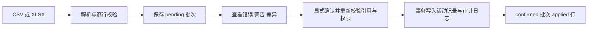

# 源数据、组织与权限管理

## 目标和范围

维护可追溯的研发源数据与 AI 属性，按定义实时计算指标。数据管理按需求、问题单、MR、代码检视四类业务数据源组织；需求数据按「设计活动 / 开发活动」维护，IR、AR、SR 是需求记录上的类型字段，不再是页面导航或统计分组。设计活动沿用既有 IR 源数据，支持页面维护、文件导入及经 AI 研发数据网关暂存的采集；开发活动使用独立记录，支持页面维护和文件导入，不进入采集链路。另有最小化的本地 AI MR 检视意见源/API，供研发能力有效检视指标计算。问题单、完整 MR/代码检视数据源和真实平台采集仍待定义或集成。真实内部平台/Gateway 联调需部署环境另行验证。

## 组织和角色

归属链为团队 → 产品 → 产品版本 → 开发迭代期。需求记录（设计活动或开发活动）必须引用一致的产品、版本和迭代，团队沿产品归属。人员工号为稳定责任人标识；未匹配工号可入库并显示待匹配，不改变记录归属。

admin 管理全局配置和全部数据；maintainer 维护绑定团队数据；viewer 只读。不同列表的可见范围由后端接口分别控制，不能把导航隐藏当成授权。密码使用 Argon2，签名 cookie session 保存用户 ID；每次请求从数据库重新读取角色。

## 团队与人员

`/settings/teams` 是全宽团队人员目录：左侧团队目录按团队筛选并管理团队本身，右侧集中列出全部可见成员，支持姓名/工号搜索、角色筛选和行内编辑。团队只维护名称和成员；产品、版本、迭代以及产品与团队的归属在「产品与版本」页面维护，不在团队人员页面出现版本映射、代码仓地址或数据源映射。

团队成员字段为姓名、工号、角色和所属团队；工号全局唯一，是源数据责任人的稳定标识。团队角色统一为 SA、SE、MDE、开发、测试五种业务概念，与系统登录角色 admin/maintainer/viewer 分离。历史自由文本角色显示为历史值，可在行内编辑中改为标准角色。管理员可新增/编辑/删除团队和成员；maintainer 只看到绑定团队且只读；viewer 只读。

`Team.source_mapping` 仍是历史/旧采集链路的持久化兼容字段，团队人员页面不展示也不编辑它；IR Gateway 采集范围已不再依赖它，而是从团队下的 PI（产品版本）层级自动派生。团队创建只需要名称，既有映射在持久化层保留。产品/版本页面通过产品的所属团队建立归属关系，避免把产品版本数据与人员主数据耦合。

团队人员支持 Excel/CSV 批量维护：模板列为团队名称、工号、姓名、角色；首次使用可下载 `.xlsx` 模板，导出包含「团队成员」和「团队」两个工作表。上传后先预览每行是新增、更新、无变化还是错误：团队名称不存在时自动创建团队；工号不存在时新增成员；工号已存在时更新姓名/角色/所属团队；角色只接受 SA/SE/MDE/开发/测试。任一行错误则整批不写入，修正后重新上传。确认导入使用单个事务；预览本身不写业务数据。

下载模板和导出对所有已登录角色开放；导出按页面可见范围：admin/viewer 导出全部团队，maintainer 只导出绑定团队。导入仅 admin 可执行。团队导入不创建临时批次表，预览结果由服务端校验后返回，确认时重新校验并整批提交。

## 产品、PI 与迭代

`/settings/products` 是全宽产品层级页，按“团队 → 产品 → PI（产品版本）→ 迭代”展示。一个产品只归属一个团队；PI 对应需求模板中的 PI 列，例如 `SCC 20.6.3.02`；每个 PI 下可以选择性维护开发迭代期，PI 不挂迭代仍然有效。页面将全部团队、产品和 PI 展开在同一层级表中，避免只选中一个产品后右侧大片空白；产品/PI/迭代的新增和编辑使用紧凑弹窗。团队、产品和 PI 行都可以单独收起/展开子层级，工具栏提供“全部收起/全部展开”；默认全部展开，搜索或团队筛选时自动展开命中分支，避免结果被收起隐藏。

产品、PI 和迭代的引用保护保持不变：产品被 PI 或需求记录引用、PI 被迭代或需求记录引用、迭代被需求记录引用时不能删除。新增产品必须选择所属团队；新增 PI 必须选择所属产品；新增迭代必须选择所属 PI，并填写开始/结束日期。角色权限与团队人员页一致：admin 可维护，maintainer/viewer 只读，maintainer 只看到绑定团队。

成熟度评估是数据管理下的独立维护入口 `/data/maturity`。admin 可选择全部团队，maintainer 固定为绑定团队，viewer 只能查看按月的成熟度汇总；维护者在活动表格编辑分值和说明，复制上月只填充草稿，整月预览在 Drawer 中确认保存，清空仍需单独确认。所有写入复用现有成熟度 API，并由后端再次校验团队权限。研发总览、研发活动和研发能力页面只读，不提供成熟度写入口。

采集计划与手动触发仅限 admin。设计活动的 IR 采集批次由 admin 全局查看/确认；maintainer 只能查看/确认所属团队的采集批次。文件批次继续按原创建者权限查看/确认。

## 管理页边界

数据网关、数据采集、用户与权限使用全宽 `admin` 页面，各自只读写自己的上下文：

- **数据网关**：Active/Draft 配置、健康状态、配置审计。配置编辑弹窗；不显示采集计划、运行历史或用户。
- **数据采集**：IR 采集计划、运行历史和团队结果；只读取 Gateway 就绪状态投影。采集范围从产品/PI 层级派生，Collect 不拥有产品/团队范围配置；未配置或硬错误时禁用启用/立即采集，DEGRADED/UNKNOWN/过期允许并警告。
- **用户与权限**：本地账号、角色、维护者团队绑定；团队只读 `id/name` 选项，不读取 `source_mapping` 或产品/PI/Gateway 数据。新增/编辑使用弹窗，保留当前账号、最后管理员和维护者必须绑定团队的保护。
- **产品与团队**：产品/PI/迭代和团队人员分别由各自页面维护；采集范围只读引用 Product/PI，不写回。

## 需求活动工作台

需求数据管理页按「设计活动 / 开发活动」两个页签组织，入口为 `/data/requirements/design`（默认）和 `/data/requirements/development`；旧 `/data/requirements/{ir|sr}` 与 `/data/{ir|sr}` 重定向到设计活动，`ar` 重定向到开发活动，`/data-management/*` 兼容路径重定向到对应入口，未知活动回退设计活动。IR、AR、SR 作为记录类型字段保留，只用于筛选，不再是页面导航或统计分组。

两个页签各自使用全宽数据工作台：内容区 PageHeader、紧凑概览、常用筛选常驻/高级筛选按需展开、列分组表格。工作台占满视口剩余高度，表格内部滚动、分页贴底；每页 10/20/50/100，默认 20。表格按需求信息、归属、责任人、AI 属性、工作量、时间、备注分组，支持视图预设、列设置、密度、排序和分页。切换页签保留各自的草稿，未保存草稿不跨页签合并。

设计活动页头为「设计活动 · SA设计 / SE设计」，提供 21 列设计模板表格、SA/SE 工作量摘要、设计模板导入和待确认采集批次条。开发活动页头为「开发活动 · 实现设计 / 编码开发」，提供 19 列开发模板表格、实现设计/开发工作量摘要和开发模板导入，不显示采集区域。

两页都支持筛选、新增、详情/编辑和单元格内联编辑；内联修改先形成草稿，底部保存条统一提交批量接口，保存后写 AuditLog，AI 字段另记字段级来源。新增/编辑抽屉按需求信息、归属、责任人、AI 属性、工作量、时间与备注分组。只读角色在页头看到紧凑只读标记且没有编辑控件；维护者的团队筛选锁定到账号绑定团队并说明原因。

设计活动摘要为需求总数、进行中、已完成、AI 使用率（SA 或 SE）和 SA/SE 工作量（含角色分解）；开发活动摘要为需求总数、进行中、已完成、AI 使用率（实现设计或开发）和实现设计/开发工作量（含角色分解）。类型筛选保留，但不作为统计分组；两个活动的摘要、记录和指标互不相加。

待确认采集区只在设计活动页、加载中或存在批次时占用页面；有批次时紧凑列出来源、团队、生成时间及有效/错误行数，并可打开共享批次复核抽屉。文件导入与采集预览都展示暂存状态、来源及文件/团队、生成时间、行数统计、警告和逐行校验；无效行仍阻止整批确认。文件导入使用「上传 → 预览与校验 → 整批确认」向导，设计活动提供 21 列 `.xlsx` 模板下载，开发活动提供 19 列 `.xlsx` 模板下载；两个模板首行都是列名，第二工作表是填写说明。

## 设计活动字段与校验

设计模板列为：需求类型、需求编号、需求标题、所属功能、进展、归属组、PI、迭代、SA、SE、AI质检等级、AI适用性、SA是否使用AI、SE是否使用AI、AI研发模式、预估工作量(SA)、实际工作量(SA)、预估工作量(SE)、实际工作量(SE)、设计时间、备注。

- 需求类型接受 IR、SR；需求编号全局唯一。
- 归属组按名称匹配团队；PI 匹配产品版本并校验属于该团队；迭代匹配并校验属于该 PI。缺失引用为错误，不自动创建主数据。
- 新建和文件导入的必填为需求类型、需求编号、需求标题、进展、归属组、PI、迭代、SA、SE、设计时间；所属功能保留但可空。
- 工号未匹配只警告，人员仍按原文入库并标记待匹配；SA 或 SE 为空为错误。
- 设计时间是唯一时间锚点，用于筛选和月度统计；不再维护开始/结束时间。内部沿用兼容字段 `completed_at`。
- 进展为未开始/进行中/完成/已关闭；AI质检等级为优秀/良好/合格/不合格；AI适用性、SA/SE 是否使用AI 为是/否；AI研发模式为自由文本，前端提供常用选项。
- 需求编号在文件内重复、已属于其他团队、引用缺失、责任人缺失、日期或枚举非法均为行错误，整批不能确认。
- 记录有效性只要求需求编号、需求标题、产品/版本/迭代和设计时间；新增必填只约束新建和文件导入，历史记录不会因为缺少后来新增的必填字段被追溯判无效或被指标排除。
- 旧字段 `responsible_employee_id`、`parent_requirement_no`、`requirement_scenario` 保留用于历史和采集兼容，不在模板中展示。

## 开发活动字段与校验

开发模板列为：类型、需求编号、标题、进展、归属组、PI、迭代、实现设计责任人、开发责任人、AI适用性、实现设计是否使用AI、开发是否使用AI、AI研发模式、预估工作量(实现设计)、实际工作量(实现设计)、预估工作量(开发)、实际工作量(开发)、开发时间、备注。

- 类型接受 IR、SR、AR；同一需求编号可以同时存在于设计活动和开发活动，两条记录独立存储，不自动关联或同步。
- 归属组、PI、迭代的匹配与校验与设计活动一致；缺失引用为错误，不自动创建主数据。
- 新建和文件导入的必填为类型、需求编号、标题、进展、归属组、PI、迭代、实现设计责任人、开发责任人、开发时间。
- 开发记录只支持页面维护和文件导入，不建立 Gateway 采集链路；文件批次与审计 domain 为 `development`。
- AI适用性、实现设计/开发是否使用AI 为是/否；AI研发模式为自由文本，前端按开发模板提供常用选项；开发时间是唯一时间锚点，用于筛选和月度统计。
- 需求编号在文件内重复、已属于其他团队、引用缺失、责任人缺失、日期或枚举非法均为行错误，整批不能确认。

## 文件导入流程

预览只写临时批次，不参与指标计算。任何无效行阻止整批确认；确认时重新验证引用和写权限。设计活动文件导入严格按设计模板必填校验；IR Gateway 采集继续使用 legacy 规则，只提供旧字段，类型缺省 IR，不要求新模板必填。开发活动只有文件导入，不建立采集链路。旧 pending 文件批次在确认时按当前活动模板重新校验，不符合时要求重新预览；采集批次保留 legacy。文件导入支持两种显式更新模式：`upsert`（默认）用非空 Excel 值覆盖正式值，空值保留；`fill_empty` 只补空字段，已有值包括 false 和 0 保留。自动采集固定 `fill_empty`。新需求编号新增记录。确认异常回滚整批；已确认批次再次确认返回冲突。工号未匹配、SA 未识别为警告，不是阻断错误。

## AI MR 检视意见源

`AIReviewOpinion` 保存每条 AI 生成的 MR 检视意见所需的最小事实：稳定 `source_id`、所属 `team_id`、意见日期 `opinion_date` 和必填布尔值 `ai_effective`。源记录不保存意见正文或 MR 文本。`PUT /api/data/code-review/opinions/{source_id}` 按稳定 ID 幂等新增/更新，admin 可写任意有效团队，maintainer 仅可写绑定团队，viewer 只读；`GET /api/data/code-review/opinions` 支持团队、日期范围及分页过滤，maintainer 结果限定为绑定团队。

有效检视指标从源记录实时计算：`mrr-effective-count` 计数 `ai_effective=true` 的意见；`mrr-effective-rate` 以有效意见数除以全部 AI 意见数。已有意见但有效数为零时显示 0；无意见或分母为零时显示缺失。`/api/compute` 先将源记录按团队和意见日期聚为日事实，再用现有时间序列计算器按请求粒度聚合；不写入派生指标 FactRecord。该 API 是 Radar 本地源契约，不表示 Gateway 已具备代码检视采集能力。

## Gateway 运行配置与就绪状态

管理员在 `/settings/gateway` 维护 AI 研发数据网关连接；该页为全宽“状态摘要 + Active/Draft 双栏 + 启用检查清单/配置审计”，配置编辑使用紧凑弹窗。`/settings/collections` 只通过只读 `GatewayStatusOut` 投影显示就绪状态并链接到该页面，不读取或展示地址、Token、Draft 配置。系统全局最多保存一个 Active 和一个 Draft。保存 Draft 不改变 Active；已有 Active 时 Token 留空表示沿用当前 Active Token，首次配置必须输入 Token。Token 按当前产品决策明文保存在 Radar 数据库，但 API、审计、CollectionRun、日志及浏览器初始化数据都不返回或记录 Token 值。生产 Gateway 地址必须使用 HTTPS。

激活 Draft 时 Radar 必须重新实时请求 readiness；只有服务标识正确、状态为 `ready` 且 SemVer 主版本兼容，才能替换 Active。先前检测成功不能替代这次检查。人工保存、检测、激活和放弃草稿写入 Gateway 配置审计；审计对 Token 只记录 `token_changed`。

Radar 只保留 Active 和 Draft 各自的最新健康观察，不建可用率历史。状态为 `UNCONFIGURED`、`UNKNOWN`、`CONNECTED`、`DEGRADED`、`UNREACHABLE`、`AUTH_FAILED`、`SERVICE_MISMATCH` 或 `PROTOCOL_INCOMPATIBLE`。认证、服务身份和协议错误一次生效；readiness 503 为 `DEGRADED`；网络连续失败 1–2 次为 `DEGRADED`，第 3 次为 `UNREACHABLE`。健康结果 90 秒后显示为过期；Radar 重启后先显示 `UNKNOWN` 和上次状态，直到即时检测完成。30 秒 Active 健康检查复用现有 APScheduler，周期检查不写审计。

## IR Gateway 采集

IR 采集由 Radar 按团队独立编排 AI 研发数据网关调用，但线协议不发送团队名称。Radar 根据团队下的产品/PI 层级自动生成产品名称和版本名称组合，不再读取 `Team.source_mapping.product_versions`；版本化能力协议是双方共同消费的实现中立事实源。Radar 负责调度、字段/层级校验、暂存、人工确认和审计，Gateway 负责内部平台认证、按产品版本组合查询和字段翻译。每个团队有独立运行结果和暂存批次，团队失败不会阻断其他团队；团队没有 PI 时跳过，Gateway 返回空结果时不创建空批次。

Gateway 同步返回最多 10000 行，窗口为带时区的半开区间 `[start_at, end_at)`。首版不分页、不异步轮询或自动重试；超限时管理员缩短窗口，失败按返回的 retryable 信息手动重跑。Radar 按产品名与版本名联合核对归属当前团队，再按该版本解析迭代名；响应超出请求产品版本范围时该行无效。Gateway 的 `business_module` 为 `null`、空字符串或纯空白时，Radar 在暂存前统一转换为 `通用模块`。任何无效行都阻止该团队批次整批确认。采集确认沿用导入的事务、只补空字段和 AI 字段来源记录，审计动作记为 `collector_confirm`；采集契约只提供旧字段，新模板字段保持空值/待维护，AI 汇总继续使用采集返回的 `ai_assisted`。

每次 CollectionRun 开始时读取一次 Active 配置，生成不可变 `GatewayRuntimeConfig` 并供所有团队共用；运行记录可以保存配置 ID 和 base URL，不保存 Token。无 Active 时运行失败并在 CollectionRun 记录一条全局错误，不向每个团队重复写相同错误。最新且未过期的认证、服务身份或协议错误可以 fail-fast；`UNKNOWN`、过期、`DEGRADED` 和 `UNREACHABLE` 仍尝试实际 IR 请求，以允许刚恢复的 Gateway 继续采集。

调度按 `Asia/Shanghai` 配置为每小时、每日、每周或每月；IR 默认禁用。每小时、每日、每周和每月分别使用上一个完整小时、自然日、自然周和自然月。管理员可以不传窗口使用上一个完整配置周期，也可以手动指定带时区的合法窗口。

完整能力语义与线协议见 [AI 研发数据网关能力协议](../contracts/ai-dev-data-gateway/README.md)。Admin-only 管理 API 与配置审计不替代源数据审计。真实内部 Gateway 及 GDEMate、CodeHub、DTS 联调仍需部署环境另行验证；项目的 Mock Gateway E2E 只覆盖 L3。

## 指标与数据边界

指标目录由代码/种子维护，与看板图表一一对应；`/settings/metrics` 的指标字典只读展示业务公式、分子/分母业务含义、数据来源、使用位置和缺失处理，不提供新增、编辑、删除或指标规则配置。源数据指标规则与结果查询原型已移除；不再提供活动/指标写接口或通用指标配置。设计活动 AI 汇总从 SA/SE 是否使用AI 推导，开发活动 AI 汇总从实现设计/开发是否使用AI 推导；设计总工作量优先使用旧总量字段，缺失时由 SA+SE 对应工作量求和。活动摘要按活动角色工作量统计，不跨活动相加；研发总览/研发活动的临时 IR KPI 只读取设计记录中的 IR 类型，SR 类型和开发记录不进入。工作台与旧 FactRecord 看板保持两条链路，统一适配尚未实现。

组织删除存在引用保护，不是统一软删除机制；具体实体需核对接口。种子重建为破坏性操作，不属于日常维护。

## 实现与相关决策

HTTP 编排见 `backend/app/data_api.py` 和 `gateway_api.py`，采集运行见 `source_collection.py`，配置生命周期与 readiness 分别见 `gateway_config.py`、`gateway_health.py`；活动需求页面见 `frontend/src/dataManagement/requirements/`，指标字典见 `frontend/src/dataManagement/metrics/`，其他数据管理与设置页面见 `frontend/src/dataManagement/` 和 `frontend/src/settings/`。Gateway 页面为 `/settings/gateway`，采集计划仍在 `/settings/collections`。规范前端入口为 `/data/requirements/design`、`/data/requirements/development`、`/data/maturity`、`/data/issues`、`/data/mr` 和 `/data/code-review`；旧需求类型路径与 `/data-management/*` 路径重定向到对应入口。测试分层见 [Testing Standards](../standards/testing.md)。

相关决策：[ADR-0003](../adr/0003-source-data-first-metrics.md)、[ADR-0004](../adr/0004-staged-import-and-field-merge.md)、[ADR-0005](../adr/0005-team-owned-product-hierarchy.md)、[ADR-0007](../adr/0007-business-source-navigation.md)、[ADR-0009](../adr/0009-versioned-ai-engineering-data-gateway-protocol.md)、[ADR-0010](../adr/0010-database-managed-gateway-runtime.md)、[ADR-0012](../adr/0012-ir-excel-import-upsert-and-field-registry.md)、[ADR-0013](../adr/0013-readonly-metric-dictionary.md)、[ADR-0016](../adr/0016-requirement-design-and-development-activity-records.md)。详细实现见 [源数据模块](../architecture/modules/data-management.md)。
