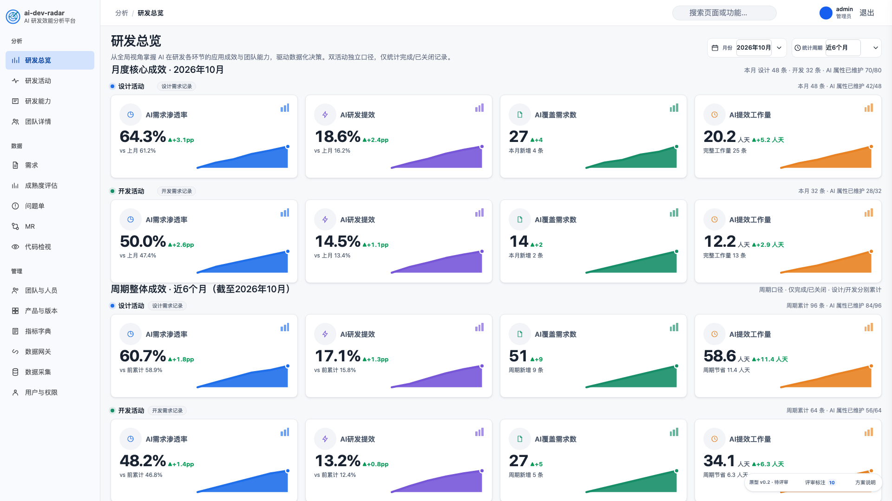
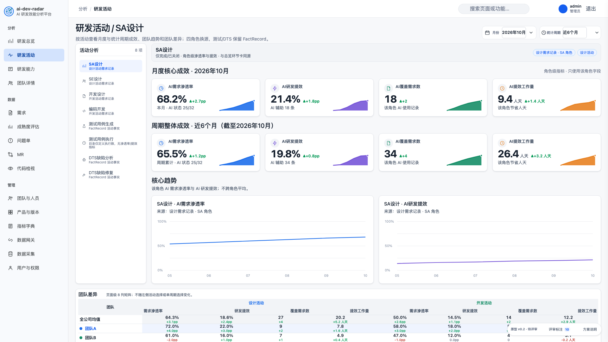
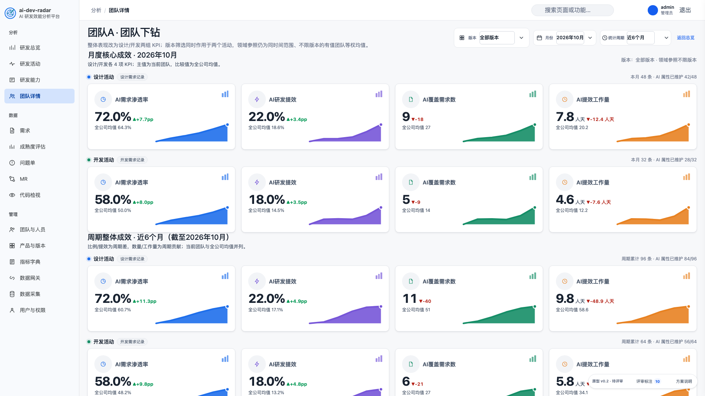

# 需求活动看板适配 · 评审原型

## 状态

**Reviewed v0.2 · 已用于实现**。用户已确认该原型作为数据正确性实现的界面依据；看板大屏视觉优化作为后续独立变更。这是评审用静态原型，不是生产实现，不连接后端、不写入数据；页面数值均为示意数据。

## 与现有界面的对齐

v0.1 使用了自绘侧栏、KPI 卡和深色评审条，与现有界面差异较大。v0.2 改为直接复用现有前端视觉系统：

- `frontend/src/design/tokens.css`、`design-system.css`、`frontend/src/app.css`：App shell、侧栏、Topbar、页头、按钮、筛选和基础卡片。
- `frontend/src/analytics/analytics.css`：Analytics 页面、KPI 卡、Panel、目录、团队矩阵和生命周期样式。
- 结构复用现有 `PageHeader`、`MetricKpiCard`、`AnalyticsSection`、`AnalyticsPanel`、`TeamMatrix` 和 Activity Directory 的类名与布局。
- 评审工具改为右下角浮动工具，不再使用占满首行的深色原型条。
- 图表仍用静态 SVG 表达趋势，生产实现会使用现有 ECharts 主题。

## 如何打开

在仓库根目录直接用浏览器打开：

```bash
open prototypes/requirement-activity-dashboard/index.html
```

无需安装依赖或启动服务。原型通过相对路径读取 `frontend/src` 的设计 token 和 CSS，因此需要保持在当前仓库结构中打开；分发单文件时需连同这些 CSS 一起打包。

## 预览







## 覆盖视图

| 视图 | 内容 |
|---|---|
| 研发总览 | 设计/开发双活动各 4 张 KPI、2×2 核心趋势、研发关键环节、8 列团队矩阵、团队预览、成熟度占位 |
| 研发活动 | 8 项活动目录、四角色指标换源、测试/DTS 保留 FactRecord、双活动页面级汇总、四项原始摘要 |
| 团队详情 | 双活动月度/周期 KPI、2×2 趋势、角色环节卡、版本范围说明、成熟度边界 |

## 建议评审路径

1. 打开页面，先看“研发总览”首屏：现在应与现有 App shell、页头筛选、KPI 卡和 Panel 视觉一致。
2. 点击右下角“评审标注”，逐条查看 10 个标注；再点“方案说明”查看公式、字段映射和范围边界。
3. 滚动到“核心趋势 / 研发关键环节 / 团队表现 / 成熟度”，检查新增双活动分组是否仍保持现有页面节奏。
4. 切换到“研发活动”：分别选择 SA设计、开发设计、测试用例生成、测试用例执行，检查来源标注和空态。
5. 切换到“团队详情”：检查双活动月度/周期 KPI、版本范围说明和趋势。
6. 分别在 1920 和 1280 宽度下检查首屏、KPI 卡换行、团队矩阵横向滚动和活动目录高度。

## 已按对齐结论实现

- 设计/开发双活动独立计算，不跨活动相加。
- 不使用设计/开发切换器；同屏分组双行 + 分组图表。
- 仅纳入进展为“完成 / 已关闭”的记录；月份按设计时间/开发时间归集。
- 计数单位为活动记录，不按需求编号跨活动去重。
- 渗透率分母为 AI 使用状态已维护的记录；AI 适用性暂不影响 KPI。
- 四张环节卡：SA/SE 取设计记录，开发设计/编码开发取开发记录；测试两卡保留 FactRecord。
- 原始摘要改为：设计 AI 覆盖数、开发 AI 覆盖数、测试用例生成数、测试用例执行数。
- 团队下钻版本筛选同时作用于两个活动；领域参照不限版本。

## 需要重点确认

- 双活动 8 张 KPI 卡的首屏密度是否可接受。
- 1280 宽下双活动 KPI 卡与 8 列团队矩阵是否需要减列或拆行。
- 四张角色卡与测试两卡的来源标注是否清楚。
- 活动页同时存在需求角色指标和 FactRecord 指标是否可接受。
- 原始摘要四项是否足够，是否需要保留旧六项作为过渡。
- 开发活动空态是否还需要显示数据覆盖说明。

## 已知限制

- 静态示意数据；月份/周期切换只演示交互，不重新计算。
- 图表是 SVG 占位，不包含真实 ECharts 交互、tooltip、图例筛选和异常点处理。
- 未实现真实版本筛选、权限、后端请求、错误重试和移动端导航抽屉。
- 视觉为评审级高保真，不替代最终 `DESIGN.md` / `UX-CONTRACT.md` 的像素验收。
- 因为直接复用前端 CSS，前端视觉 token 更新后原型会同步变化；原型不是独立设计系统。

## 相关设计

- [Change Design](../../docs/changes/completed/requirement-activity-dashboard.md)
- [Analytics 业务口径](../../docs/business/analytics.md)
- [Analytics 架构说明](../../docs/architecture/overview.md)
- [ADR-0016：需求数据按设计与开发活动独立记录](../../docs/adr/0016-requirement-design-and-development-activity-records.md)
